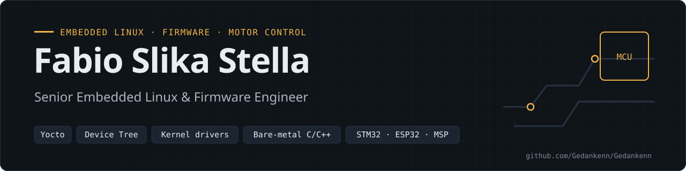

<p align="center">
  
</p>

<p align="center">
  <a href="https://gedankenn.github.io/Gedankenn/"></a>
  <a href="https://github.com/Gedankenn/Curriculo/blob/main/Curriculo_Fabio_Stella_EN.pdf"></a>
  <a href="https://github.com/Gedankenn/Curriculo/blob/main/Curriculo_Fabio_Stella_PT.pdf"></a>
  <a href="https://www.linkedin.com/in/fabio-slika-stella-6a37b513a/"></a>
  <a href="mailto:fabioslikastella@gmail.com"></a>
  <a href="https://x.com/Th00rBeardedOne"></a>
</p>

## whoami

Computer Engineer working on **R&D embedded systems** at **Control iD** (Systems Developer II): production Embedded Linux images with **Yocto/BitBake**, **Device Tree** and **Linux kernel drivers**, plus bare-metal **C/C++** on ARM Cortex-M (MSP, STM32, ESP32) for access-control devices, focused on sensing, security and real-time control.

I build low-level software where **physics, electrons and code collide**: system bring-up, drivers, bootloaders, control loops. At home with oscilloscopes, logic analyzers, datasheets and a Linux terminal.

```console
$ whoami
fabio — embedded linux & firmware engineer
$ cat ~/.education
B.S. Computer Engineering — UTFPR, Pato Branco/PR
$ cat ~/.previously
Progress Rail (Caterpillar) · Zeentech/Stellantis · InoBram · IAV do Brasil · Xpert Automação
$ echo $STACK
close_to_the_metal()
```

## R&D focus

```text
▸ embedded linux: yocto/bitbake, device tree, kernel drivers, BSP
▸ firmware architecture & system bring-up
▸ bare-metal & RTOS development
▸ drivers, HALs, BSPs, bootloaders & OTA
▸ hardware bring-up & board validation
▸ real-time control & sensor integration
▸ field protocols — CAN/J1939, RS485, I²C, SPI, UART
▸ embedded networking & IPv6
▸ linux-based development & automation
```

## Toolchain

**Languages**
         

**Embedded Linux**
      

**MCUs**
    

**Interfaces**
       

**Frameworks & Tooling**
            

## Featured

| Project | What it is | Status |
|---|---|---|
| [**power_profiller**](https://github.com/Gedankenn/power_profiller) | ESP32 + INA226 energy profiler: ~36 Hz serial CSV, live Wi-Fi dashboard, burst & battery-life analysis | working |
| [**ESP32-FOC**](https://github.com/Gedankenn/ESP32-FOC) | ESP32 firmware toward FOC of BLDC motors; open-loop V/F today | WIP |
| [**3-phase-inverter**](https://github.com/Gedankenn/3-phase-inverter) | 3× IR2110 + 6× IRF540N inverter for BLDC motors | study |
| [**OTPC**](https://github.com/Gedankenn/OTPC) | Open Traction PMSM Controller, simulation-first | phase 0 |
| [**Kalman BLDC sim**](https://github.com/Gedankenn/Python-Simulation-of-BLDC-motor-using-Kalman-Filter) | UTFPR thesis: BLDC + FOC + Extended Kalman Filter | complete |

## Projects

> `★` public on GitHub · `◎` local / early stage

### Embedded & Firmware

| | Project | Description |
|---|---|---|
| ★ | [**ESP32-FOC**](https://github.com/Gedankenn/ESP32-FOC) | Field-Oriented Control of BLDC motors on ESP32 |
| ★ | [**OTPC**](https://github.com/Gedankenn/OTPC) | Open Traction PMSM Controller |
| ★ | [**power_profiller**](https://github.com/Gedankenn/power_profiller) | Real-time energy profiling — ESP32 + INA226 |
| ★ | [**esp32_drivers**](https://github.com/Gedankenn/esp32_drivers) | Custom ESP32 peripheral drivers |
| ★ | [**esp32_wattimeter**](https://github.com/Gedankenn/esp32_wattimeter) | ESP32-based wattimeter |
| ★ | [**esp32_bootloader**](https://github.com/Gedankenn/esp32_bootloader) | Custom ESP32 bootloader / OTA · WIP |
| ★ | [**3-phase-inverter**](https://github.com/Gedankenn/3-phase-inverter) | 3-phase inverter module study · WIP |
| ◎ | bt-headphone | Custom Bluetooth headphones — ESP32 + PCM5102A + TPA6132A2 spec & design |

### Hardware & PCB Design

| | Project | Description |
|---|---|---|
| ★ | [**esp32_mini**](https://github.com/Gedankenn/esp32_mini) | Minimal ESP32-C3 dev board — KiCad PCB design |
| ◎ | kicad | Dracula theme for KiCad |

### AI & Machine Learning

| | Project | Description |
|---|---|---|
| ◎ | LuxTTS | High-performance TTS — voice cloning, 48kHz, 150x realtime, <1GB VRAM |
| ◎ | MetaMe | Personal digital twin — clones communication style via Ollama LLM |
| ◎ | mono | Configurable AI assistant framework — personas, CLI & web UI |

### Web Applications

| | Project | Description |
|---|---|---|
| ★ | [**pato**](https://github.com/Gedankenn/pato) | PatoAgenda AI — WhatsApp chatbot for appointment scheduling |
| ◎ | MyFinances | Personal finance app — Django + HTMX + AI advisor + bank sync |

### Tools & Utilities

| | Project | Description |
|---|---|---|
| ★ | [**FileTransfer**](https://github.com/Gedankenn/FileTransfer) | Custom file transfer protocol over raw Ethernet — C |
| ★ | [**mysocket**](https://github.com/Gedankenn/mysocket) | Own socket wrapper in C |
| ◎ | ytDownload | YouTube video/audio downloader CLI — Python + yt-dlp |
| ◎ | sigrok-ht6p20b-decoder | Sigrok/PulseView decoder for HT6P20B OOK encoder IC |
| ◎ | raspi4 | Arch Linux ARM flash utility for Raspberry Pi 4 |

### Linux & Desktop

| | Project | Description |
|---|---|---|
| ★ | [**third-impact**](https://github.com/Gedankenn/third-impact) | Evangelion-inspired theme for Omarchy |
| ★ | [**magi**](https://github.com/Gedankenn/magi) | Caelestia-style edge drawers & MAGI dashboard for Omarchy (QML) |
| ★ | [**omaweather**](https://github.com/Gedankenn/omaweather) | Weather plugin for Omarchy |
| ★ | [**oled-look**](https://github.com/Gedankenn/oled-look) | Hyprland OLED-like LCD grade — 6500 K screen shader |
| ★ | [**nvim**](https://github.com/Gedankenn/nvim) | Personal Neovim config — Lua |
| ★ | [**site-genner**](https://github.com/Gedankenn/site-genner) | Static site generator — TypeScript |


### Data & Simulation

| | Project | Description |
|---|---|---|
| ★ | [**Kalman BLDC sim**](https://github.com/Gedankenn/Python-Simulation-of-BLDC-motor-using-Kalman-Filter) | BLDC motor simulation with Kalman filter |
| ★ | [**simulador-b3**](https://github.com/Gedankenn/simulador-b3) | B3 stock exchange simulator |
| ★ | [**stocks**](https://github.com/Gedankenn/stocks) | Terminal stock portfolio |
| ◎ | inmet_data | Brazil INMET weather data — parsing & visualization (2000–2026) |

## System stats

<p align="center">
  
</p>

<p align="center">
  
</p>

## Philosophy

```text
▸ understand the system before optimizing it
▸ measure before guessing
▸ read the datasheet
▸ respect physics
▸ automate everything repeatable
▸ keep firmware boring and reliable
```

## Connect

| | |
|---|---|
| Email | [fabioslikastella@gmail.com](mailto:fabioslikastella@gmail.com) |
| LinkedIn | [fabio-slika-stella](https://www.linkedin.com/in/fabio-slika-stella-6a37b513a/) |
| Portfolio | [gedankenn.github.io/Gedankenn](https://gedankenn.github.io/Gedankenn/) |
| CV | [English](https://github.com/Gedankenn/Curriculo/blob/main/Curriculo_Fabio_Stella_EN.pdf) · [Português](https://github.com/Gedankenn/Curriculo/blob/main/Curriculo_Fabio_Stella_PT.pdf) |
| X | [@Th00rBeardedOne](https://x.com/Th00rBeardedOne) |

---

<p align="center">
  <sub><b>© 2026 Fabio Slika Stella</b> · Embedded Linux &amp; Firmware · close to the metal, fueled by coffee</sub>
</p>
