<!-- Profile README v2 · HUD amber theme. Assets: assets/readme/*-dark.svg / *-light.svg
     (generated by design/build/make_profile_v2.py; fonts IBM Plex Sans + JetBrains Mono, SIL OFL 1.1, subset & embedded). -->

  <picture><source media="(prefers-color-scheme: dark)" srcset="assets/readme/hero-dark.svg"><source media="(prefers-color-scheme: light)" srcset="assets/readme/hero-light.svg"></picture>

  
  
  
  

<picture><source media="(prefers-color-scheme: dark)" srcset="assets/readme/h01-about-dark.svg"><source media="(prefers-color-scheme: light)" srcset="assets/readme/h01-about-light.svg">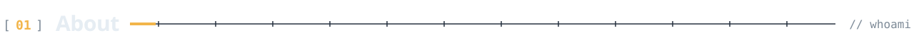</picture>

Computer Engineer (UTFPR) shipping **firmware and Embedded Linux on production devices** in electronic security, railway and automotive. Today I'm **Systems Developer II at Control iD**, where I own production Embedded Linux images (**Yocto/BitBake, Device Tree, Linux kernel drivers**) and write bare-metal **C/C++** on three ARM Cortex-M families (**MSP, STM32, ESP32**): bootloader, OTA and board bring-up, plus cryptography, Ethernet/TCP-IP and MQTT.

I build low-level software where **physics, electrons and code collide**. My research roots are in motor control: Field-Oriented Control of BLDC/PMSM motors and Extended Kalman Filter state estimation. At home with oscilloscopes, logic analyzers, datasheets and a Linux terminal.

<picture><source media="(prefers-color-scheme: dark)" srcset="assets/readme/principles-dark.svg"><source media="(prefers-color-scheme: light)" srcset="assets/readme/principles-light.svg"></picture>

<picture><source media="(prefers-color-scheme: dark)" srcset="assets/readme/h02-stack-dark.svg"><source media="(prefers-color-scheme: light)" srcset="assets/readme/h02-stack-light.svg">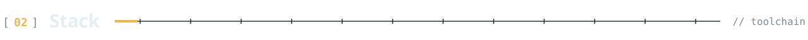</picture>

<picture><source media="(prefers-color-scheme: dark)" srcset="assets/readme/stack-dark.svg"><source media="(prefers-color-scheme: light)" srcset="assets/readme/stack-light.svg"></picture>

<picture><source media="(prefers-color-scheme: dark)" srcset="assets/readme/h03-projects-dark.svg"><source media="(prefers-color-scheme: light)" srcset="assets/readme/h03-projects-light.svg">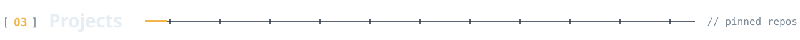</picture>

  <a href="https://github.com/Gedankenn/power_profiller"><picture><source media="(prefers-color-scheme: dark)" srcset="assets/readme/card-power_profiller-dark.svg"><source media="(prefers-color-scheme: light)" srcset="assets/readme/card-power_profiller-light.svg">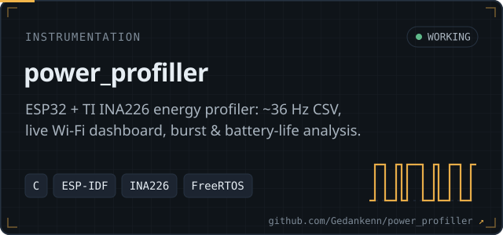</picture></a>
  <a href="https://github.com/Gedankenn/ESP32-FOC"><picture><source media="(prefers-color-scheme: dark)" srcset="assets/readme/card-ESP32-FOC-dark.svg"><source media="(prefers-color-scheme: light)" srcset="assets/readme/card-ESP32-FOC-light.svg">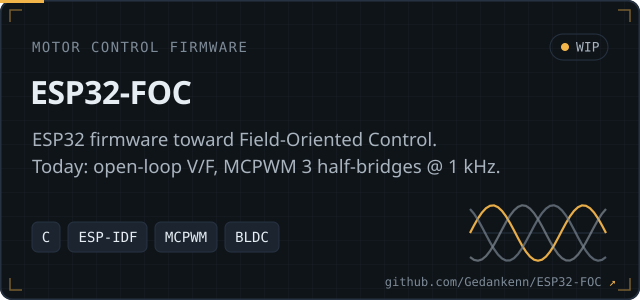</picture></a>

  <a href="https://github.com/Gedankenn/3-phase-inverter"><picture><source media="(prefers-color-scheme: dark)" srcset="assets/readme/card-3-phase-inverter-dark.svg"><source media="(prefers-color-scheme: light)" srcset="assets/readme/card-3-phase-inverter-light.svg">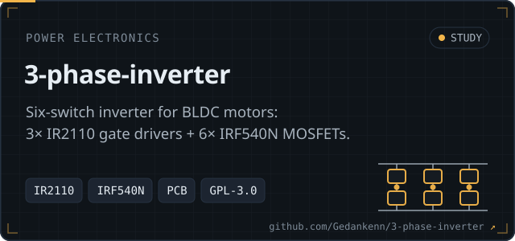</picture></a>
  <a href="https://github.com/Gedankenn/OTPC"><picture><source media="(prefers-color-scheme: dark)" srcset="assets/readme/card-OTPC-dark.svg"><source media="(prefers-color-scheme: light)" srcset="assets/readme/card-OTPC-light.svg">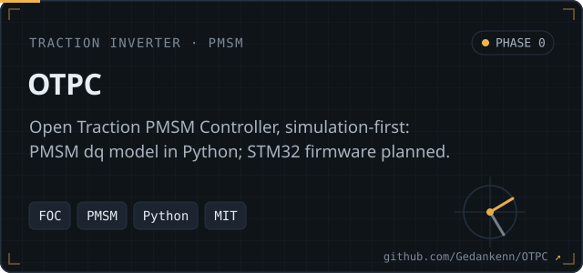</picture></a>

  <a href="https://github.com/Gedankenn/Python-Simulation-of-BLDC-motor-using-Kalman-Filter"><picture><source media="(prefers-color-scheme: dark)" srcset="assets/readme/card-Python-Simulation-of-BLDC-motor-using-Kalman-Filter-dark.svg"><source media="(prefers-color-scheme: light)" srcset="assets/readme/card-Python-Simulation-of-BLDC-motor-using-Kalman-Filter-light.svg">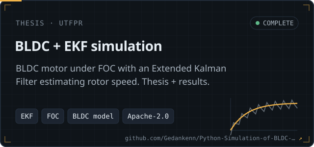</picture></a>
  <a href="https://github.com/Gedankenn/arduino_temp_sensor"><picture><source media="(prefers-color-scheme: dark)" srcset="assets/readme/card-arduino_temp_sensor-dark.svg"><source media="(prefers-color-scheme: light)" srcset="assets/readme/card-arduino_temp_sensor-light.svg">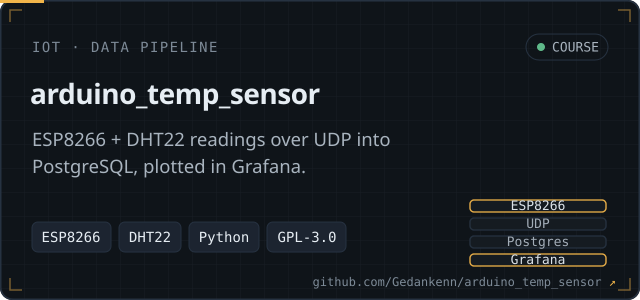</picture></a>

<b>All repositories</b> · <code>ls ~/projects</code>

### Embedded & Firmware

| Project | Description |
|---|---|
| [**ESP32-FOC**](https://github.com/Gedankenn/ESP32-FOC) | Field-Oriented Control of BLDC motors on ESP32 |
| [**OTPC**](https://github.com/Gedankenn/OTPC) | Open Traction PMSM Controller |
| [**power_profiller**](https://github.com/Gedankenn/power_profiller) | Real-time energy profiling — ESP32 + INA226 |
| [**esp32_drivers**](https://github.com/Gedankenn/esp32_drivers) | Custom ESP32 peripheral drivers |
| [**esp32_wattimeter**](https://github.com/Gedankenn/esp32_wattimeter) | ESP32-based wattimeter |
| [**esp32_bootloader**](https://github.com/Gedankenn/esp32_bootloader) | Custom ESP32 bootloader / OTA · WIP |
| [**3-phase-inverter**](https://github.com/Gedankenn/3-phase-inverter) | 3-phase inverter module study · WIP |

### Hardware & PCB Design

| Project | Description |
|---|---|
| [**esp32_mini**](https://github.com/Gedankenn/esp32_mini) | Minimal ESP32-C3 dev board — KiCad PCB design |

### Web Applications

| Project | Description |
|---|---|
| [**pato**](https://github.com/Gedankenn/pato) | PatoAgenda AI — WhatsApp chatbot for appointment scheduling |

### Tools & Utilities

| Project | Description |
|---|---|
| [**FileTransfer**](https://github.com/Gedankenn/FileTransfer) | Custom file transfer protocol over raw Ethernet — C |
| [**mysocket**](https://github.com/Gedankenn/mysocket) | Own socket wrapper in C |

### Linux & Desktop

| Project | Description |
|---|---|
| [**third-impact**](https://github.com/Gedankenn/third-impact) | Evangelion-inspired theme for Omarchy |
| [**magi**](https://github.com/Gedankenn/magi) | Caelestia-style edge drawers & MAGI dashboard for Omarchy (QML) |
| [**omaweather**](https://github.com/Gedankenn/omaweather) | Weather plugin for Omarchy |
| [**oled-look**](https://github.com/Gedankenn/oled-look) | Hyprland OLED-like LCD grade — 6500 K screen shader |
| [**nvim**](https://github.com/Gedankenn/nvim) | Personal Neovim config — Lua |
| [**site-genner**](https://github.com/Gedankenn/site-genner) | Static site generator — TypeScript |

### Data & Simulation

| Project | Description |
|---|---|
| [**Kalman BLDC sim**](https://github.com/Gedankenn/Python-Simulation-of-BLDC-motor-using-Kalman-Filter) | BLDC motor simulation with Kalman filter |
| [**simulador-b3**](https://github.com/Gedankenn/simulador-b3) | B3 stock exchange simulator |
| [**stocks**](https://github.com/Gedankenn/stocks) | Terminal stock portfolio |

<picture><source media="(prefers-color-scheme: dark)" srcset="assets/readme/h04-experience-dark.svg"><source media="(prefers-color-scheme: light)" srcset="assets/readme/h04-experience-light.svg">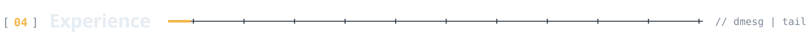</picture>

<picture><source media="(prefers-color-scheme: dark)" srcset="assets/readme/experience-dark.svg"><source media="(prefers-color-scheme: light)" srcset="assets/readme/experience-light.svg">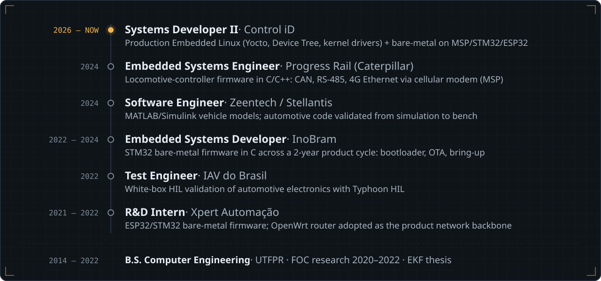</picture>

Full history in the CV: <a href="https://github.com/Gedankenn/Curriculo/blob/main/Curriculo_Fabio_Stella_EN.pdf">English</a> · <a href="https://github.com/Gedankenn/Curriculo/blob/main/Curriculo_Fabio_Stella_PT.pdf">Português</a>

<picture><source media="(prefers-color-scheme: dark)" srcset="assets/readme/h05-contact-dark.svg"><source media="(prefers-color-scheme: light)" srcset="assets/readme/h05-contact-light.svg">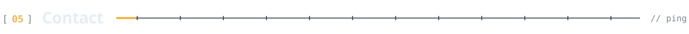</picture>

  
  
  
  

Pato Branco, PR, Brazil · UTC−3 · Portuguese (native) · English (advanced)

<picture><source media="(prefers-color-scheme: dark)" srcset="assets/readme/footer-dark.svg"><source media="(prefers-color-scheme: light)" srcset="assets/readme/footer-light.svg"></picture>

